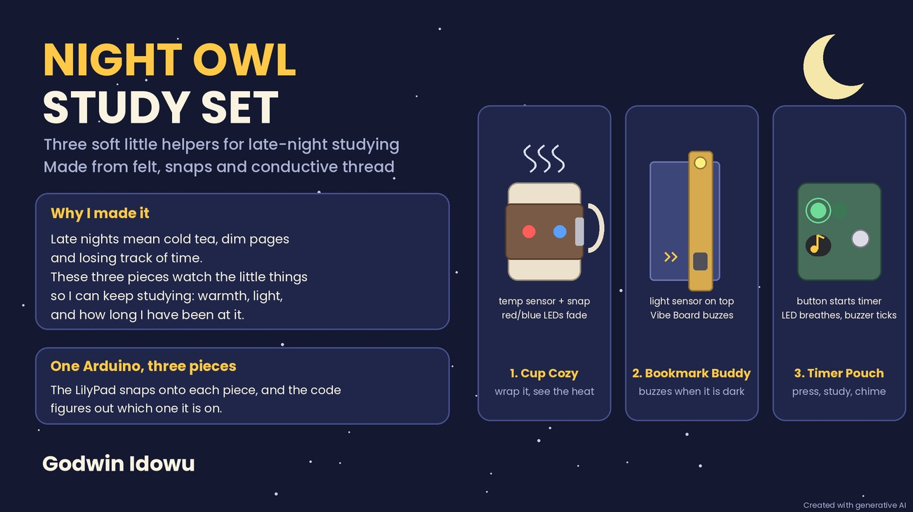
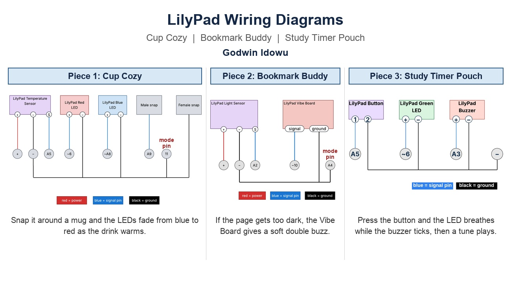

My final project is the **Night Owl Study Set**, three small felt pieces that help with late-night studying. One LilyPad Arduino snaps onto each piece, and the code figures out which piece it is on.

## Slide 1: The pitch

*Slide created with generative AI.*

## Slide 2: Circuit sketches

*Sketches drawn by me.*

## The three pieces

**1. Cup Cozy.** A felt sleeve for a mug. When I wrap it around a mug and snap it shut, the snap closes a homemade switch. A temperature sensor on the inside touches the mug, and a red LED and a blue LED fade between each other, so a hot drink glows red and a cold drink glows blue. Steam swirls on the outside are stitched with conductive thread, and the stitches are also the wiring.

**2. Bookmark Buddy.** A felt bookmark that sits in my textbook with the light sensor peeking out of the top. If the page gets too dark to read, the Vibe Board gives a soft double buzz as a reminder to turn on a light.

**3. Study Timer Pouch.** A small felt pouch for a pencil. When I press the button, a timer starts. While it runs, an LED slowly fades up and down, the buzzer ticks, and a countdown keeps going, all at the same time. When time is up, the buzzer plays a short tune.

## Materials

**Already have:**
- LilyPad USB Plus Arduino and ProtoSnap parts (light sensor, buzzer, button)
- LilyPad temperature sensor
- LilyPad Vibe Board
- Red, blue and green single-color LEDs
- Snaps
- A mug (for measuring and the demo)

**Need to acquire:**
- Conductive thread
- Embroidery floss
- Felt

## How it meets the requirements

- **Analog input:** the temperature sensor (Cup Cozy) and the light sensor (Bookmark Buddy).
- **Analog output:** the buzzer playing different pitches (Study Timer Pouch).
- **Input controls output in every piece:** the snap and temperature sensor control the LEDs, the light sensor controls the Vibe Board, and the button controls the LED and buzzer.
- **Sewn with conductive thread:** all three pieces.
- **Simultaneous, different behavior:** the Study Timer Pouch runs a breathing LED, a ticking buzzer and a countdown at the same time.
- **Stitchwork:** the steam swirls on the Cup Cozy are conductive thread that is also the wiring.
- **Homemade switch:** the snap closure on the Cup Cozy.
- **2 inputs, 2 outputs:** the Cup Cozy (snap switch and temperature sensor in, red and blue LEDs out).

## Rough draft of my 1-minute pitch

Hi, I'm Godwin, and my project is the Night Owl Study Set.

Late-night studying comes with cold tea, dim pages, and losing track of time. So I made three small pieces that keep an eye on those things.

The first is a Cup Cozy. You wrap it around a mug and snap it shut, and the snap is my homemade switch. A temperature sensor reads the mug, and red and blue lights fade to show if your drink is hot or cold.

The second is a Bookmark Buddy. Its light sensor sits at the top of the page, and if the page gets too dark, it buzzes softly to remind you to turn on a light.

The third is a Study Timer Pouch. Press the button, and a light breathes, a buzzer ticks, and a timer counts down all at the same time, then a little tune plays when it is done.

One Arduino snaps onto each piece, and the code knows which one it is on. Thank you!

## Sources

- Parts and pin names come from the course component list and slides.
- Slide 1 was created with generative AI. The circuit sketches on slide 2 are my own drawings.
