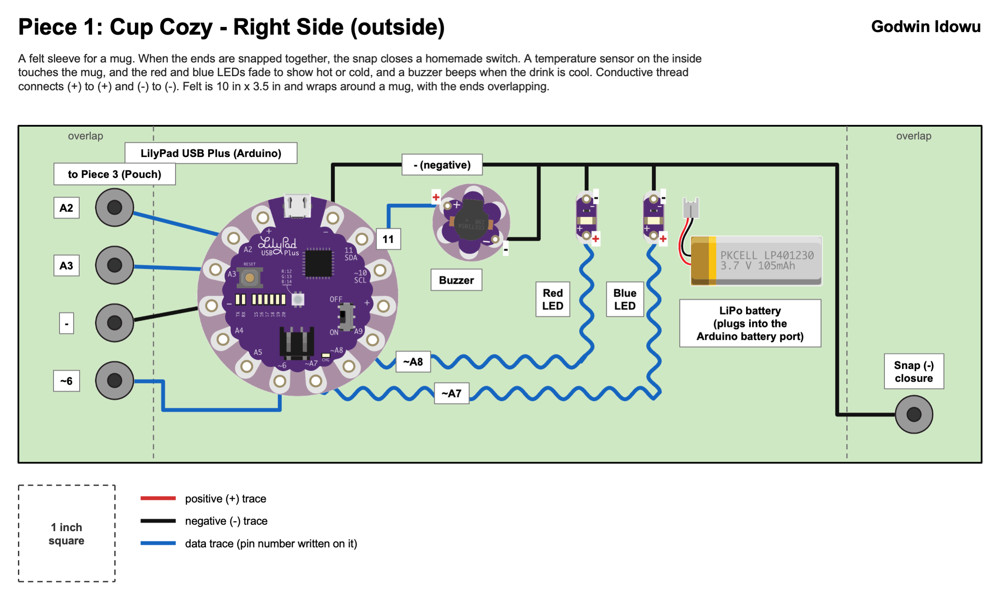
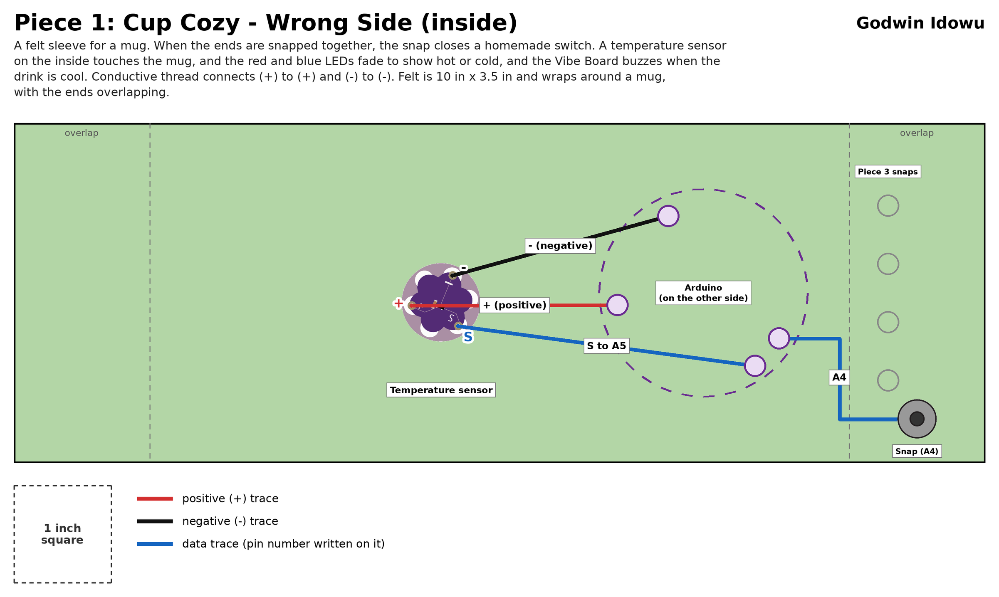
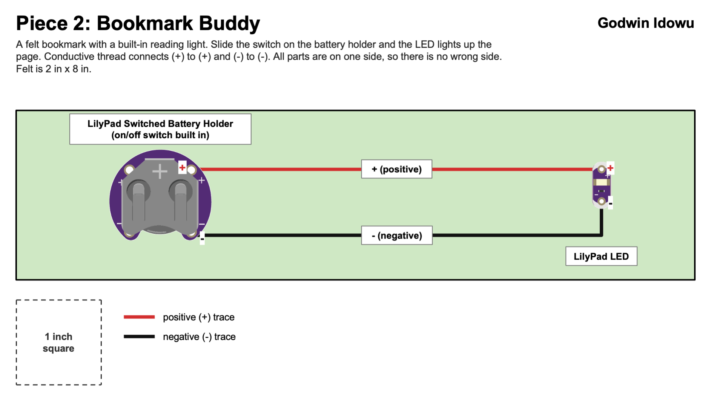
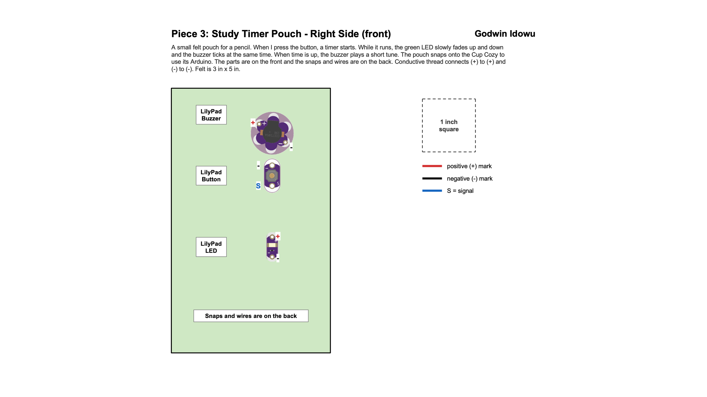
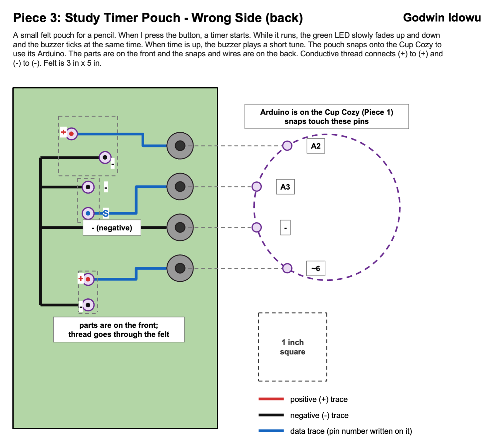

## Night Owl Study Set

The Night Owl Study Set is three small felt pieces that help with late-night studying. The Cup Cozy keeps an eye on my drink, the Bookmark Buddy lights up my page, and the Study Timer Pouch times my study session. The Pouch snaps onto the Cup Cozy and borrows its Arduino. The Bookmark Buddy is a simple circuit so it has no Arduino.

## Piece 1: Cup Cozy

A felt sleeve that wraps around a mug. When the ends are snapped together, the snap closes a homemade switch. A temperature sensor on the inside touches the mug and the red and blue LEDs fade to show if the drink is hot or cold. A buzzer beeps when the drink is cool. The Arduino is sewn onto the outside. This piece uses both sides of the felt so there are two images.

**Right side (outside)**

**Wrong side (inside)**

## Piece 2: Bookmark Buddy

A felt bookmark with a built-in reading light. I slide the switch on the battery holder and the LED lights up the page. It is a simple circuit with no Arduino. All the parts are on one side so there is only one image.

## Piece 3: Study Timer Pouch

A small felt pouch for a pencil. When I press the button, a timer starts. While it runs, the green LED slowly fades up and down and the buzzer ticks at the same time. When time is up, the buzzer plays a short tune. The pouch snaps onto the Cup Cozy to use its Arduino. The parts are on the front and the snaps and wires are on the back so there are two images.

**Right side (front)**

**Wrong side (back)**

