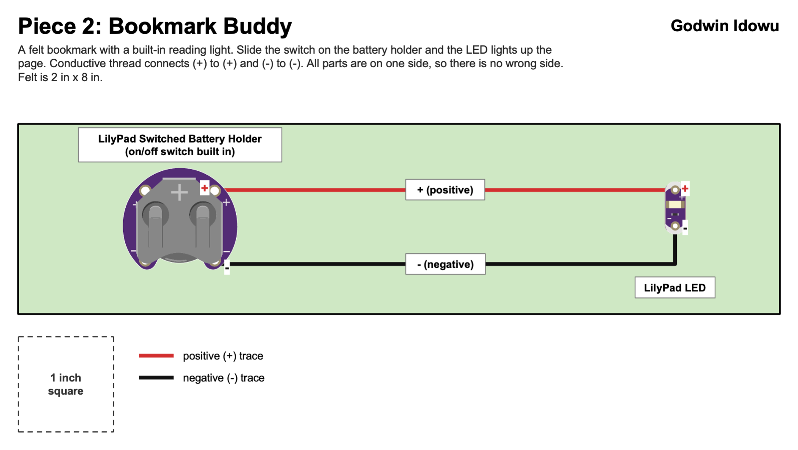
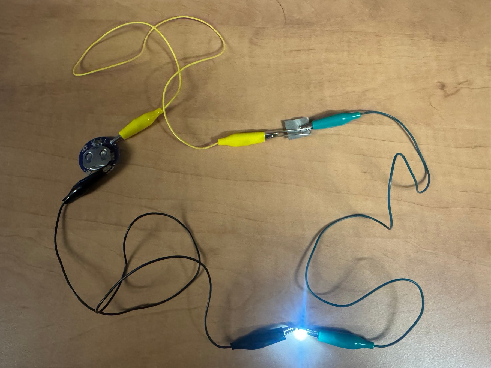
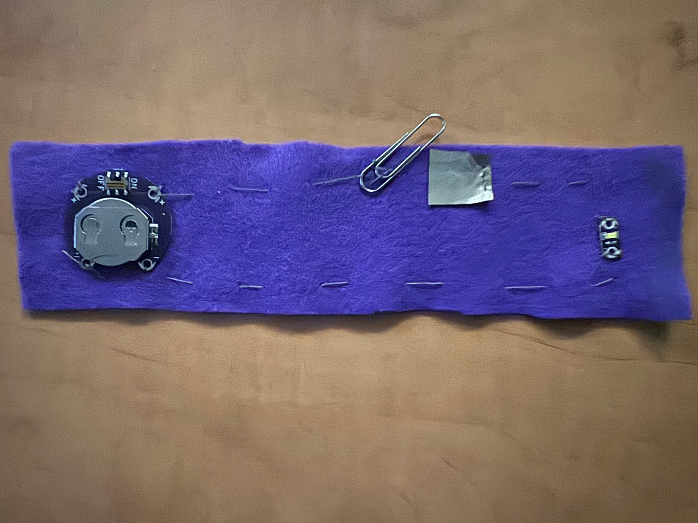
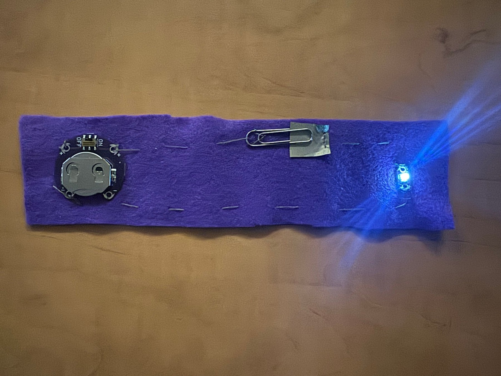

## Bookmark Buddy

Bookmark Buddy is a felt bookmark with a tiny light. It has a battery holder, an LED, and a paperclip that works as a switch. When I swing the paperclip onto a small square of conductive fabric, the LED turns on and lights up my page. When I swing it away, the light goes off. There is no Arduino and no code in this piece.

**Why I made it:** I study late at night, and the page I am reading is often too dark. A lamp can disturb the people around me. I wanted a small light that stays inside the book and shines right on my page. This is also the simplest piece of my Night Owl Study Set. The other two pieces use an Arduino, but this one is just a battery, an LED and a switch, so it was a good place to start.

## Materials

- Felt, 2 in x 8 in (mine is purple)
- LilyPad Switched Battery Holder (I leave its own switch ON)
- Coin battery that fits the holder
- 1 white LilyPad LED
- 1 paperclip
- A small square of conductive fabric (about 1/2 in)
- Conductive thread (3 pieces, about 1 ft each)
- Needle and scissors
- Ruler (to measure and cut the felt)
- Plain thread or pins to hold the parts in place
- 3 alligator clips (for testing before sewing)

## Paper prototype

This is the front of the felt. The red thread is the positive (+) side and the black thread is the negative (-) side. One end of the paperclip is sewn down, and the other end swings onto the fabric patch. Everything is on one side, so there is only one picture. The real felt is purple, and I drew it green just to make the picture easy to read.

## Alligator clip test

Before I sewed anything, I tested the circuit with three alligator clips. One clip joins the battery holder (+) to the paperclip. One joins the fabric patch to the LED (+). One joins the battery holder (-) to the LED (-). When the paperclip touched the patch, the LED turned on, so I knew the plan worked.

## It works: two states

**Off.** The paperclip is swung away from the patch, so nothing is connected and the LED is off.

**On.** The paperclip is resting on the fabric patch, so the circuit is complete and the LED is glowing.

## Two tips for my past self

1. **Keep the metal tips of your alligator clips apart.** My LED stayed dark at first because the two clips on it were touching each other. That skips the LED completely. Spread the clips so each one only touches its own hole.
2. **Check the simple things first.** In my first test, the paperclip was lying a few inches away from the patch, so nothing happened. Before you start changing the wiring, make sure the switch is really touching.
